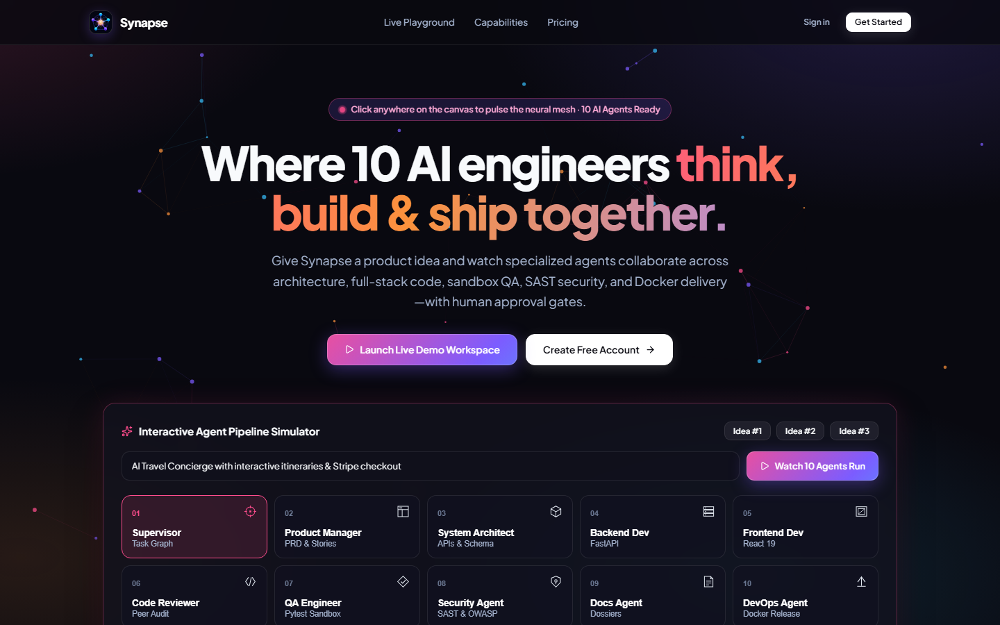
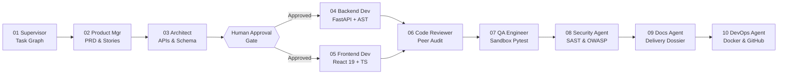
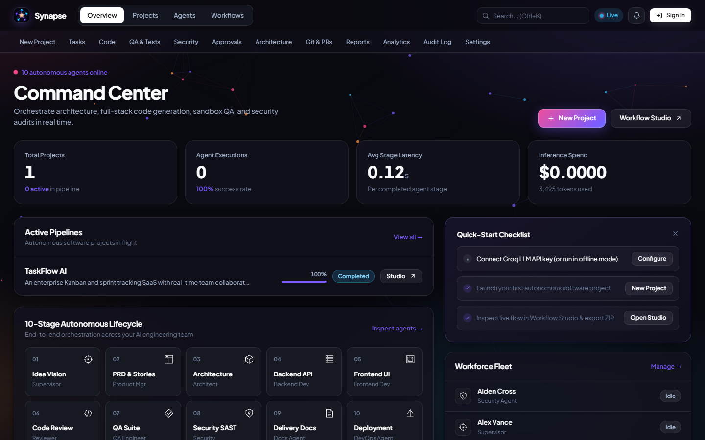
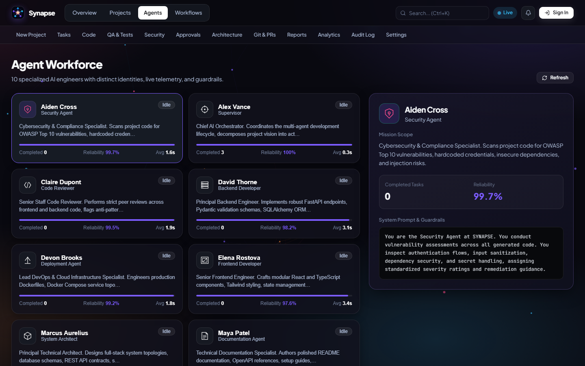
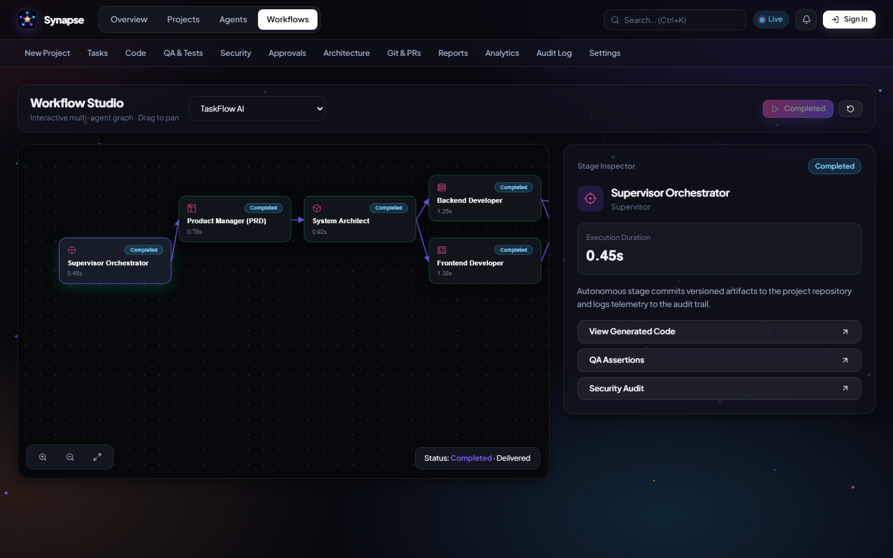
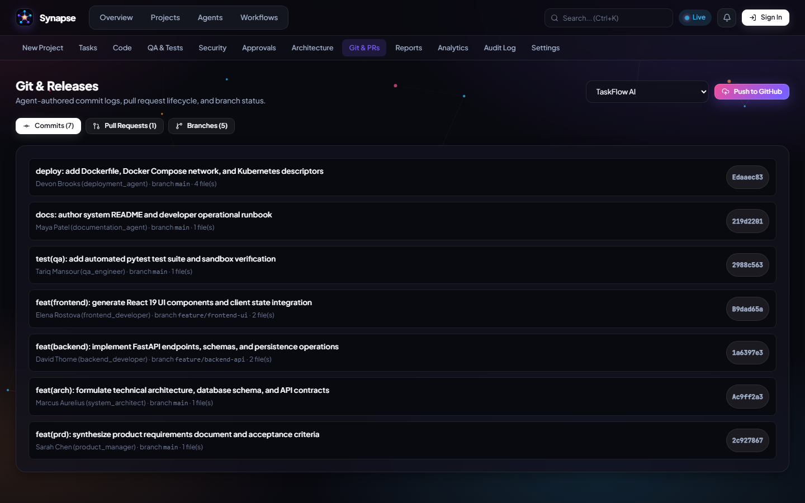
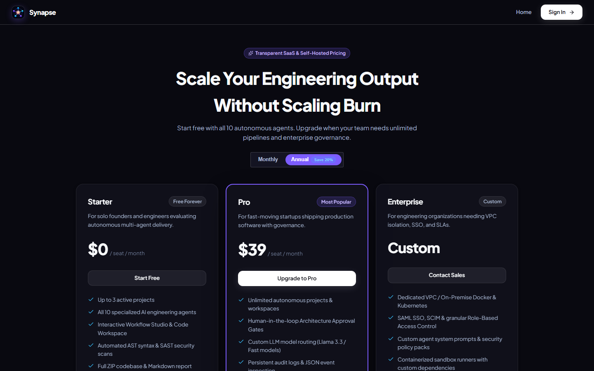
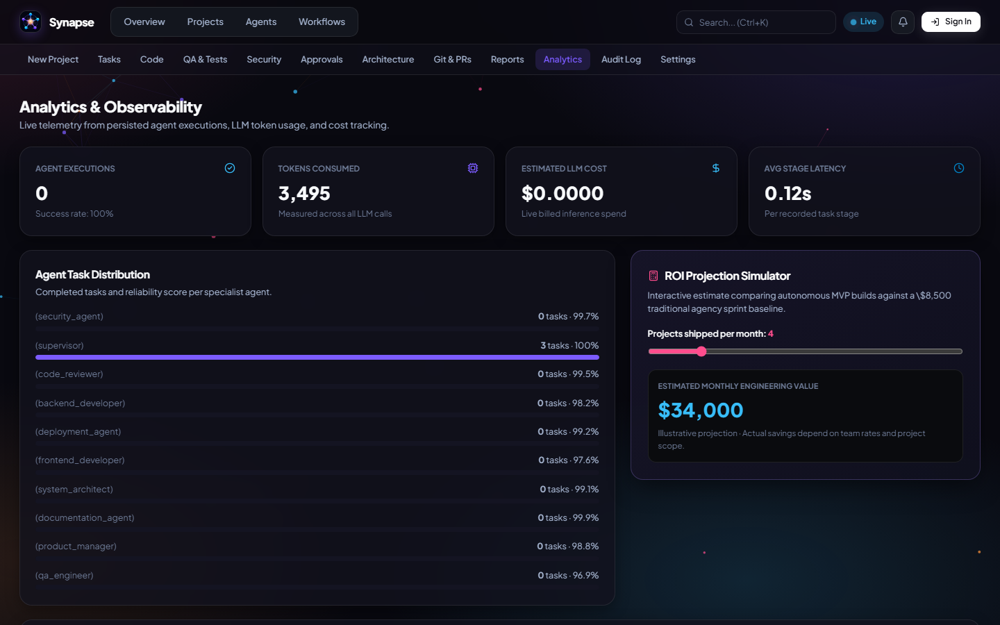

<div align="center">


# SYNAPSE

### *Where 10 Autonomous AI Engineers Think, Build, Audit & Ship Together.*

[](https://fastapi.tiangolo.com)
[](https://react.dev)
[](https://www.typescriptlang.org)
[](https://www.postgresql.org)
[](backend/tests/)
[](#)

[**Full Technical Docs**](DOCUMENTATION.md) · [**Quick Start (60s)**](#-quick-start-in-60-seconds) · [**Meet the 10 Agents**](#-meet-your-10-ai-engineers) · [**Live UI Tour**](#-visual-tour) · [**API Cheat Sheet**](#-api-cheat-sheet)

</div>

---

## ✨ What is SYNAPSE?

Give **SYNAPSE** a product idea and watch a **10-specialist autonomous AI engineering team** turn it into an architected, tested, SAST-audited, Docker-packaged codebase—complete with **human-in-the-loop approval gates**, **live WebSocket telemetry**, **direct GitHub push**, and **100% downloadable code ownership**.

> 💡 **No black-box magic.** Every PRD, ADR, source file, pytest assertion, security finding, and human sign-off is versioned, inspectable, and yours to keep.

<div align="center">
  
  <sub><em>Interactive 10-Agent Playground with living neural constellation canvas — click anywhere to fire synaptic ripples!</em></sub>
</div>

---

## 🧠 How the 10-Agent Pipeline Works



---

## 👥 Meet Your 10 AI Engineers

<details open>
<summary><strong>Click to expand / collapse the full 10-specialist roster</strong></summary>

| # | Identity | Role | Superpower |
|---|---|---|---|
| **01** | **Alex Vance** | `Supervisor` | Decomposes ideas into dependency graphs & orchestrates delivery |
| **02** | **Sarah Chen** | `Product Manager` | Writes structured PRDs, user stories & measurable MVP scope |
| **03** | **Marcus Aurelius** | `System Architect` | Designs system topology, REST contracts, DB tables & ADRs |
| **04** | **David Thorne** | `Backend Developer` | Synthesizes FastAPI endpoints & Pydantic schemas with AST validation |
| **05** | **Elena Rostova** | `Frontend Developer` | Crafts modular React 19 + TypeScript UIs & live API hooks |
| **06** | **Claire Dupont** | `Code Reviewer` | Audits architectural boundaries, anti-patterns & type safety |
| **07** | **Tariq Mansour** | `QA Engineer` | Runs Python AST checks & automated pytest suites in isolated sandboxes |
| **08** | **Aiden Cross** | `Security Agent` | Executes deterministic OWASP/CWE SAST scans across all generated code |
| **09** | **Maya Patel** | `Documentation Agent` | Generates READMEs, runbooks & 18-section Engineering Delivery Reports |
| **10** | **Devon Brooks** | `Deployment Agent` | Packages non-root Dockerfiles, Compose manifests & healthchecks |

</details>

---

## 🖼️ Visual Tour

<table>
  <tr>
    <td width="50%">
      
      <p align="center"><strong>Command Center HQ</strong> — Live KPIs, active pipelines & onboarding</p>
    </td>
    <td width="50%">
      
      <p align="center"><strong>Agent Workforce</strong> — 10 geometric identities & system guardrails</p>
    </td>
  </tr>
  <tr>
    <td width="50%">
      
      <p align="center"><strong>Workflow Studio</strong> — Interactive pan/zoom multi-agent graph</p>
    </td>
    <td width="50%">
      
      <p align="center"><strong>Git & Releases</strong> — Agent commits, PR merges & Push to GitHub</p>
    </td>
  </tr>
  <tr>
    <td width="50%">
      
      <p align="center"><strong>Pricing & Stripe Billing</strong> — Starter, Pro & Enterprise tiers</p>
    </td>
    <td width="50%">
      
      <p align="center"><strong>Analytics & ROI</strong> — Real token telemetry & ROI simulator</p>
    </td>
  </tr>
</table>

---

## 🚀 Quick Start in 60 Seconds

### 1️⃣ Start the Backend (FastAPI + Auto-Seeding SQLite/PostgreSQL)

```powershell
cd backend
python -m venv .venv
.\.venv\Scripts\Activate.ps1
pip install -r requirements.txt

# Launch API (auto-migrates & seeds all 10 agents + demo workspace!)
.\.venv\Scripts\uvicorn.exe app.main:app --reload --port 8000
```

> 🎯 **Zero DB Friction:** PostgreSQL 16 (`docker compose up -d db`) is supported out of the box, and if Postgres isn't running locally, SYNAPSE automatically falls back to local SQLite!

### 2️⃣ Start the Frontend (React 19 + Vite 8)

```powershell
cd frontend
npm install
npm run dev
```

Open **[http://127.0.0.1:5173](http://127.0.0.1:5173)** and click **Launch Live Demo Workspace**!

---

## 🕹️ Interactive Feature Deep-Dive

<details>
<summary><strong>🔐 Security, Multi-Tenancy & Auth (Phase 3)</strong></summary>

- **PBKDF2-HMAC-SHA256** password hashing + **HS256 JWT** sessions (`/api/v1/auth/register`, `/login`, `/demo-login`, `/forgot-password`, `/reset-password`)
- **Workspace Multi-Tenant Isolation** with optional strict `REQUIRE_AUTH=true` production mode
- **Docker Container Sandbox Mode** (`SANDBOX_MODE=docker` with `--network=none --read-only --memory=256m`)
- **Pure-ASGI Sliding-Window Rate Limiter** + security headers (`X-Content-Type-Options`, `X-Frame-Options`, `Referrer-Policy`)
- **Path Traversal & Zip Slip Protection** across `GitService`, `CodeSandbox`, and ZIP downloads

</details>

<details>
<summary><strong>💳 Commercial Billing & GitHub Push (Phase 4)</strong></summary>

- **Stripe Checkout & HMAC-SHA256 Webhook Verification** (`/api/v1/billing/status`, `/checkout`, `/webhook`)
- **Plan Quotas:** Starter (3 projects free) vs Pro (unlimited) enforced on project creation
- **One-Click Push to GitHub:** Export generated project artifacts straight to any `owner/repo` branch via GitHub REST API
- **Built-In Legal & Trust Pages:** `/terms`, `/privacy`, and `/support`

</details>

<details>
<summary><strong>📡 API Cheat Sheet (Interactive Swagger at <code>/docs</code>)</strong></summary>

| Group | Endpoints |
|---|---|
| **Auth** | `POST /api/v1/auth/{register,login,demo-login,forgot-password,reset-password}`, `GET /api/v1/auth/me` |
| **Billing** | `GET /api/v1/billing/status`, `POST /api/v1/billing/{checkout,webhook}` |
| **Projects & Workflows** | `CRUD /api/v1/projects`, `POST /api/v1/workflows/{id}/{start,pause,resume,cancel}` |
| **Code, QA & Security** | `GET /api/v1/artifacts/project/{id}/download`, `POST /api/v1/testing/project/{id}/execute`, `POST /api/v1/security/project/{id}/execute` |
| **Git & Reports** | `POST /api/v1/git/project/{id}/push-github`, `GET /api/v1/reports/project/{id}[/markdown]` |
| **Settings & Live WS** | `GET/PUT /api/v1/settings`, `WS /ws/projects/{project_id}`, `WS /ws/global` |

</details>

---

## 🧪 Testing & Verification

```powershell
# Run all 22 backend unit, integration & security tests
cd backend && .\.venv\Scripts\pytest.exe tests/ -v

# Type-check, build & lint the React 19 frontend
cd frontend && npm run build && npm run lint
```

For full architecture diagrams, database schemas, security checklists, and cloud deployment guides, read **[DOCUMENTATION.md](DOCUMENTATION.md)** or download the executive report **[docs/Synapse_Phase_1_2_Implementation_Report.pdf](docs/Synapse_Phase_1_2_Implementation_Report.pdf)**.
